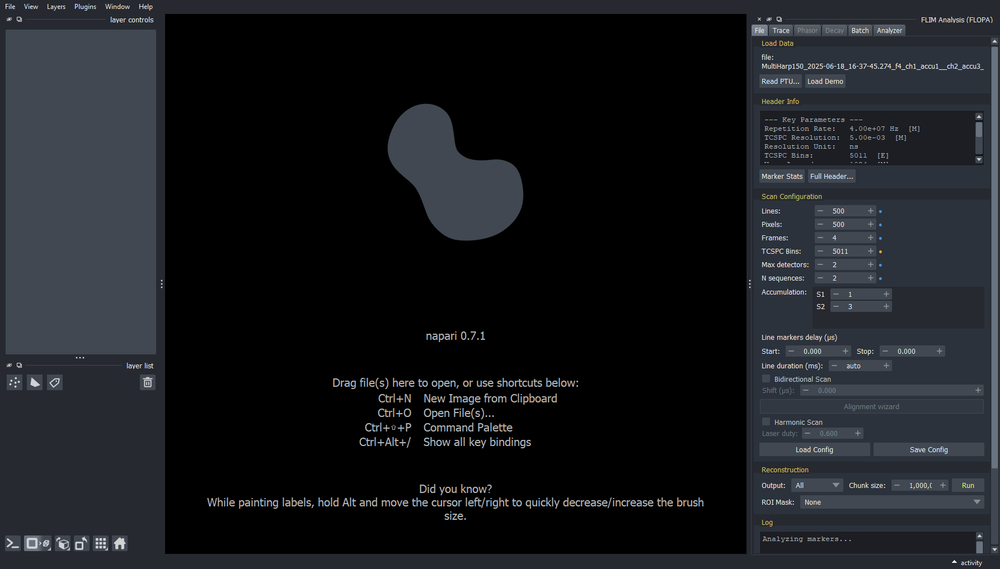
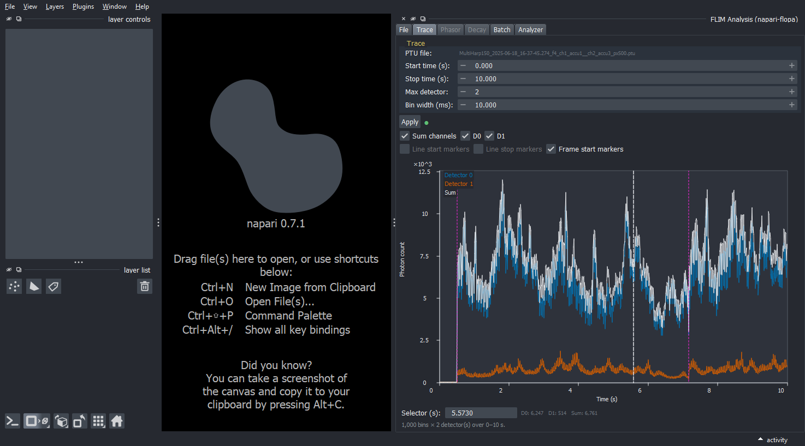
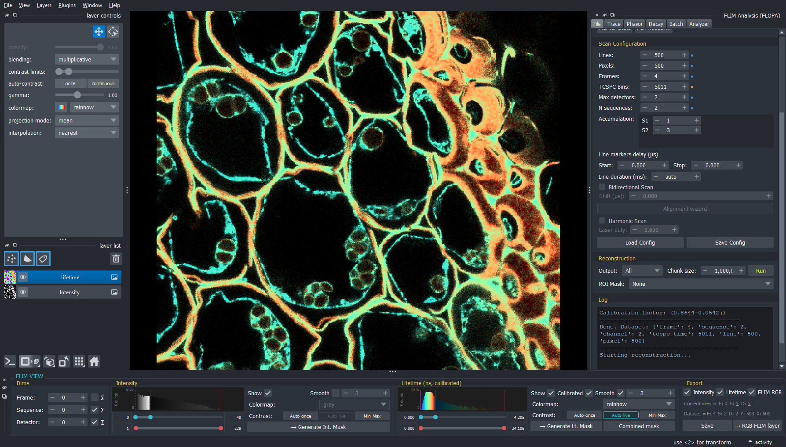
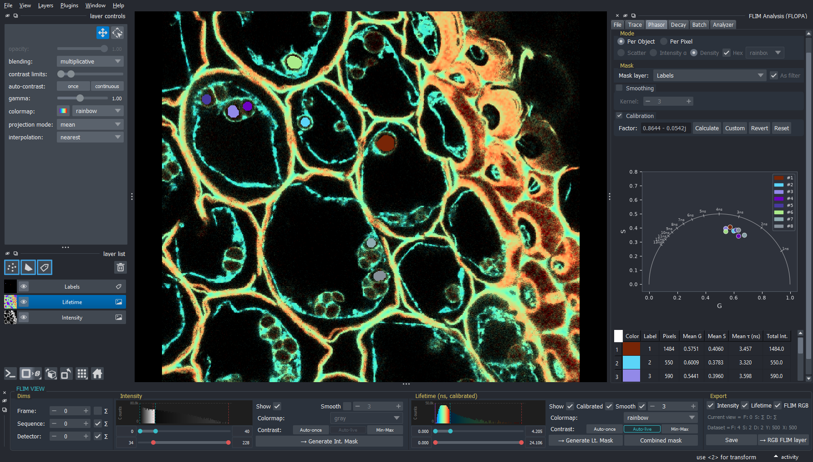
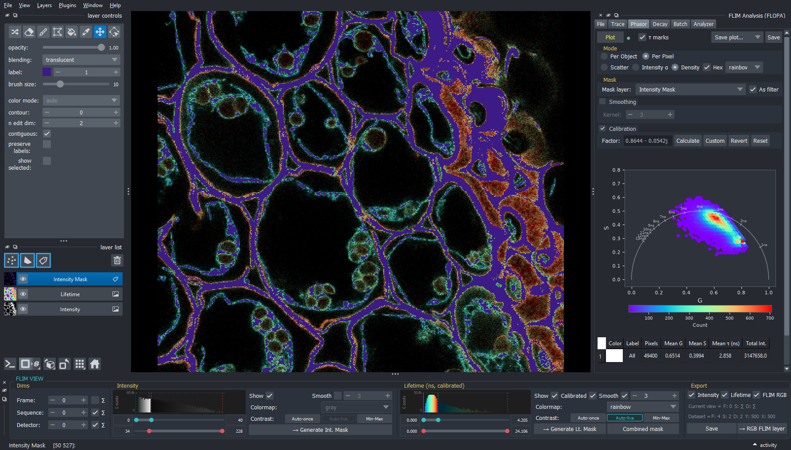
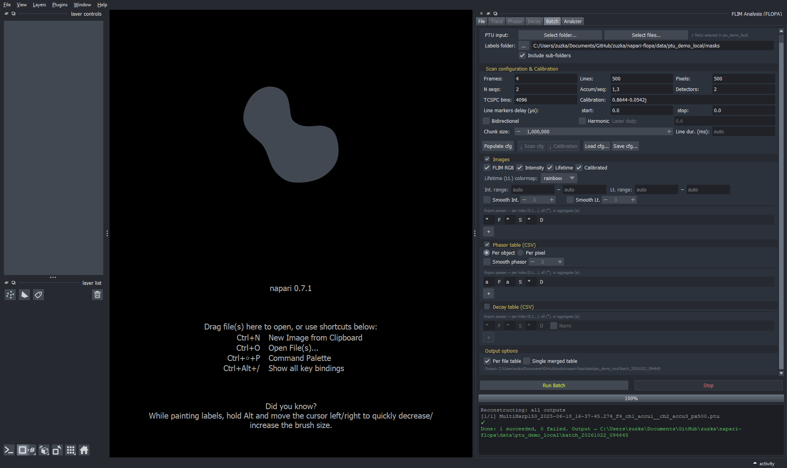

# napari-flopa

[](LICENSE)
[](https://napari.org/stable/plugins/index.html)
[](https://pypi.org/project/napari-flopa)
[](https://python.org)


> **Work in progress** — the plugin is functional but under active development. Expect breaking changes between versions.

A [napari] plugin for opening, processing and analysing FLIM (Fluorescence Lifetime Imaging Microscopy) data from `.ptu` files.

## Feature panels

- **File**
  - read a `.ptu`, display its header, reconstruct it into an xarray dataset (photon count, mean arrival time, phasor, TCSPC histogram)
  - supports multi-frame, multi-sequence (with line accumulation) and multi-detector data
  - bidirectional scans with an **Alignment wizard** for the line-marker delays
  - scan config with value provenance, saved/loaded as JSON
  - marker statistics
  - optional ROI mask to reconstruct only part of the field
  - **Drag and drop** — a `.ptu` or scan-config `.json` dropped onto napari opens in the File tab

  

- **Trace**
  - photon-count time trace per detector over a chosen time window and bin width, with line/frame marker overlays

  


- **FLIM View** (bottom dock)
  - intensity and lifetime display with histogram contrast sliders (Auto-once, Auto-live, Min-Max), smoothing
  - frame/sequence/detector selection or summing
  - lifetime *Calibrated* by the IRF delay from the phasor calibration
  - intensity, lifetime and combined masks as Labels layers
  - FLIM RGB composite
  - export to TIFF/PNG

  

- **Phasor**
  - per-object or per-pixel phasor plot as scatter, intensity-weighted scatter or density (square or hex bins), smoothing
  - colour by a Labels layer or use it as a filter
  - calibration from a reference lifetime or a custom factor

  <p>
    
    
  </p>

- **Decay**
  - TCSPC decay curves with frame/sequence/detector aggregation, per-detector toggles, normalisation and log scale
- **Batch**
  - process a folder (or selected files, opt. with sub-folders and label masks) with a shared scan config and calibration
  - export of images (FLIM RGB, intensity, lifetime), phasor tables per object or per pixel and decay tables (raw or normalised), per file or merged

  

- **Analyzer**
  - explore phasor CSV tables (from Phasor or Batch)
  - colour by any column
  - per-group density contours, mean/median and covariance ellipses
  - calibration
  - compute phase and modulation lifetimes
  - compute 2- and 3-component fractions
  - clustering (K-means, hierarchical; Gaussian mixture, DBSCAN, HDBSCAN with scikit-learn)
  - row filtering, regex grouping and column combining in **Data tools**


## Requirements

- Python ≥ 3.11
- [napari] with a Qt backend

## Installation

Install into the environment where napari runs. Pick one:


**From PyPI**

```bash
pip install napari-flopa            # plugin only, for an existing napari install
pip install "napari-flopa[all]"     # plugin + napari + Qt
```

Use the plain (non-`[all]`) form when you already have napari installed.

Optional: `pip install "napari-flopa[cluster]"` adds scikit-learn for the
Analyzer's Gaussian mixture, DBSCAN and HDBSCAN clustering (K-means and
hierarchical clustering work without it).

**From source**

```bash
git clone https://github.com/cockovaz/napari-flopa
cd napari-flopa
pip install -e ".[all]"      # editable install, napari + Qt included
```


## Getting started

1. **Open the plugin**
Start napari and choose **Plugins → FLOPA → FLIM Analysis**.

2. **Load a file**
In the **File** tab, click **Load Demo** for the bundled demo dataset, or **Read PTU…** for your own — or drop a `.ptu` onto the napari window.
    > Note: the coloured dot beside each field says where its value came from - file metadata, a default, an estimate, or your own edit.

3. **Set the scan geometry**
Frames, lines, pixels, sequences and accumulations must match how the image was actually acquired, because the raw file is a stream of photon and marker events with no image shape of its own. The header contains some information, fill in the rest. **Demo dataset** is loaded with the correct configuration set up.
**Marker Stats** inspects the marker events and suggests dimensions. For bidirectional scans, the **Alignment wizard** estimates the line-marker delays.

4. **Reconstruct**
  Pick what to compute under **Output**.   Optionally pick an **ROI Mask** (a Labels layer or a mask file) to keep only the photons inside it.
  - *Intensity* — photon-count image only, the fastest
- *Int. + τ* — adds the mean arrival time (lifetime) image
- *All* — adds phasor coordinates per pixel and the global TCSPC decay (enables the **Phasor** and **Decay** tabs)

5. **Look at the result**
The **FLIM View** dock opens at the bottom, with a
histogram for Intensity and one for Lifetime. Each has two sliders: the **cyan** one sets the display contrast, the **red** one a threshold range. **→ Generate Int./Lt.
Mask** turns that range into a napari Labels layer. Once a calibration is enabled in the Phasor tab, **Calibrated** shows the lifetime with the IRF delay subtracted (negative values are wrapped around by one period).
Intensity, lifetime and the FLIM RGB composite can be exported from here.

6. **Analyze**
  - **Phasor** plots g/s per object or per pixel — apply a calibration factor, pick a Labels layer to colour by object or to restrict the plot to a region.
  - **Decay** plots the global TCSPC curves per slice. **FLIM View** shows only decay of slice configuration currently shown in FLIM View.

7. **Reuse the settings**
Use the **Batch** tab to run a whole folder of `.ptu` files with identical settings. Or export multiple slices of a single file. Each export pass picks frames, sequences and detectors as an index, `*` (all, one output per value) or `a` (aggregate).


## Data model

Reading and reconstructing `.ptu` files is done by **[tttrkit]** (imported as
`tttrkit.ptuio`), a separate package developed alongside this plugin. It is a
normal dependency and is installed automatically — see [tttrkit] for the raw
TTTR parsing, scan reconstruction and phasor maths that sit underneath the GUI.

Reconstruction produces a single `xarray.Dataset` holding up to five variables.

Four of them are images and share the dimensions
`(frame, sequence, line, pixel, channel)`: `photon_count`, `mean_arrival_time`,
`phasor_g` and `phasor_s`. Here `line` and `pixel` are the spatial axes and
`channel` is the detector axis.

The fifth, `tcspc_histogram`, is the global decay: its
dimensions are `(frame, channel, tcspc_channel)` with no spatial axes.


## Roadmap

Planned updates:

- **Interactive phasor** — lasso a region of the plot and paint the matching pixels
  back into the image as a napari Labels layer
- **Decay fitting** — extract lifetimes from the TCSPC curves
- **Region-wise decay** — curves per mask and per object, not only per frame/detector
- **Wider import support** — `.ptu` from further scanning systems, and other formats
  (`.sdt`, …)


## License

Distributed under the terms of the [MIT] license.
`napari-flopa` is free and open source software.

## Issues

If you encounter any problems, please [file an issue] along with a detailed description.

[napari]: https://github.com/napari/napari
[tttrkit]: https://github.com/panekdal/tttrkit
[MIT]: http://opensource.org/licenses/MIT
[file an issue]: https://github.com/cockovaz/napari-flopa/issues
[issues]: https://github.com/cockovaz/napari-flopa/issues
[pip]: https://pypi.org/project/pip/
